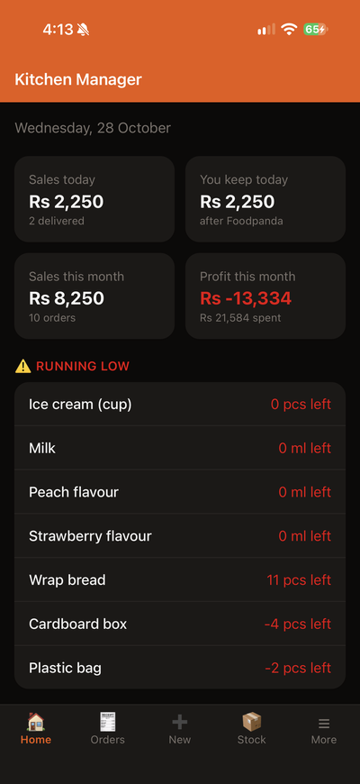
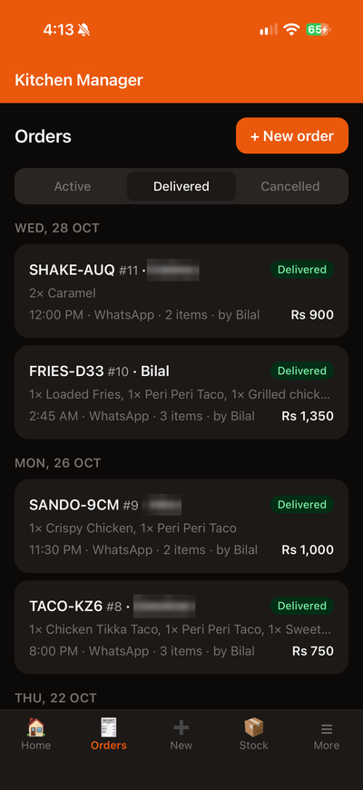
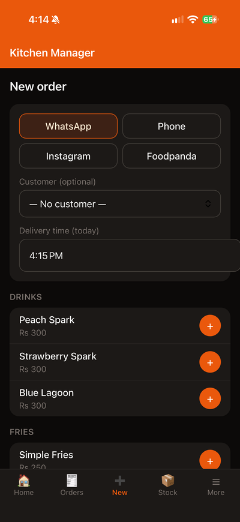
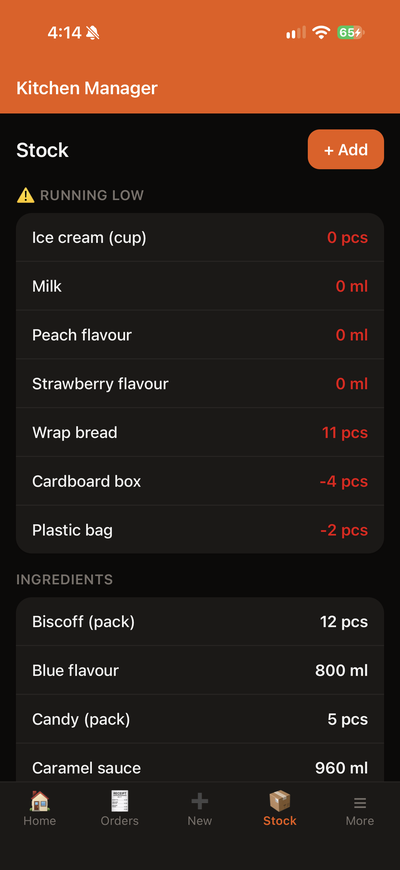
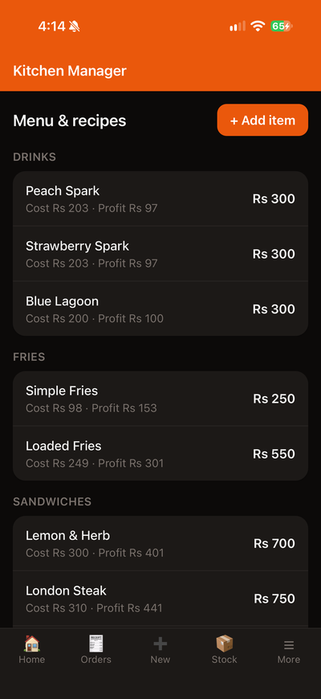
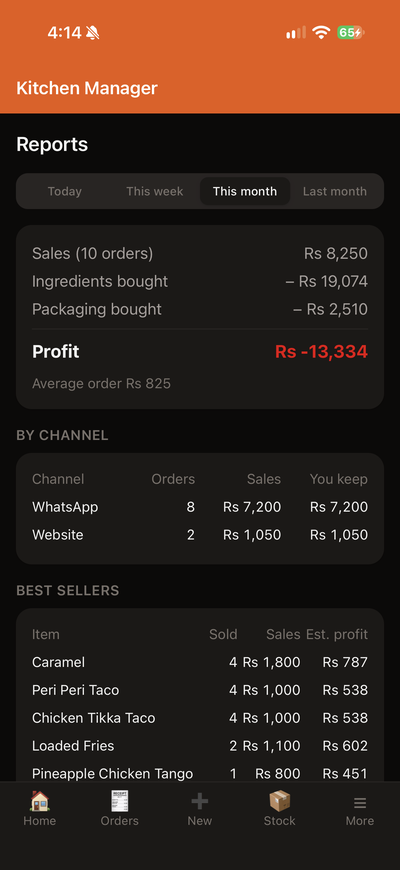
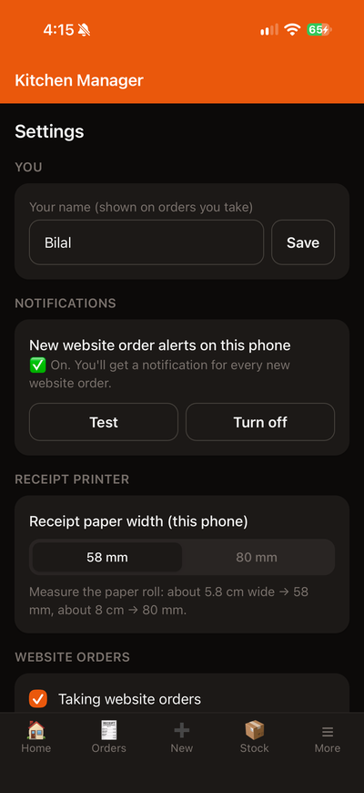
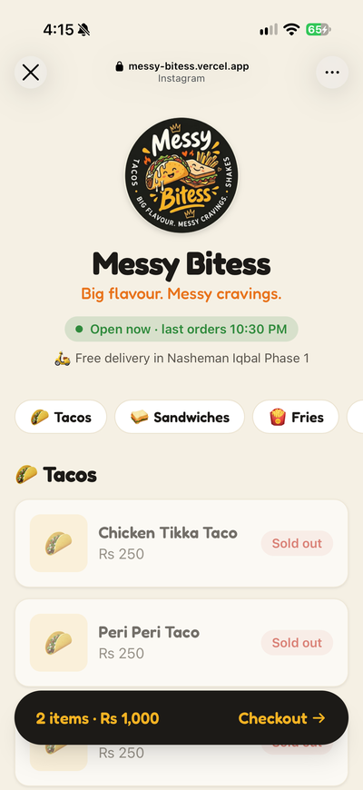
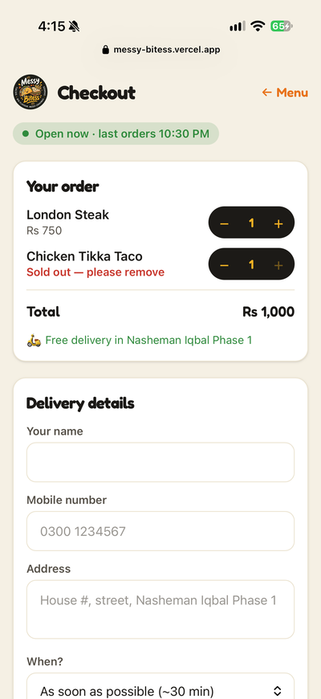

# Home Kitchen POS

A free, phone-first system for running a small home food business: take orders from WhatsApp,
phone, Instagram, Foodpanda and your own ordering website; track stock automatically from
recipes; record expenses; and see real profit.

Built for a two-person home kitchen in Pakistan, and kept configurable so anyone can use it.
Everything runs on free tiers (Supabase + Vercel), with no app store and no monthly fees.

## Screenshots

From **Messy Bitess**, the home kitchen this was built for (customer names blurred).
A fresh copy starts as "Demo Kitchen" with a placeholder logo.

**Staff app**

| Home | Orders | New order |
|:---:|:---:|:---:|
|  |  |  |

| Stock | Menu & recipes | Reports |
|:---:|:---:|:---:|
|  |  |  |

| Settings | Customer website | Website checkout |
|:---:|:---:|:---:|
|  |  |  |

## What's included

**Staff app** (`app/`): an installable web app for iPhone and Android.

- **Orders:**
  - one-tap order entry with live totals
  - statuses: New → Pending → Preparing → Delivered
  - cash, bank or mobile-wallet payments
  - Foodpanda prices and commission
- **Automatic stock:**
  - recipes per menu item, so delivering an order deducts its ingredients and packaging
  - low-stock warnings that count what pending orders still need
  - stock history for every ingredient
- **Restocking and expenses:**
  - restocking adds stock, updates the cost and records the expense in one step
  - expenses by month
- **Reports:**
  - sales, commission, expenses and profit by day, week or month
  - best sellers with estimated profit per item
  - sales by channel
- **Customer messages:**
  - WhatsApp messages on "Start preparing" and "Mark delivered" (free click-to-chat, pre-filled; you tap Send)
  - receipts for 58/80 mm thermal printers, or shared as an image
- **New-order alerts:**
  - push notifications to every staff phone, with reminders every 3 minutes until the order is accepted
  - a loud in-app alarm
- **Records:** customers with order history, and which staff member took each order.

**Customer website** (`site/`): a public ordering site in your branding.

- **Ordering:**
  - menu with automatic **Sold out** labels, based on stock
  - open/closed banner and opening hours
  - cart, checkout (ASAP or a time later today), cash on delivery or mobile wallet
- **Order status page:** a private link showing Received → Confirmed → Preparing → Delivered.
- **Customer-friendly order codes,** such as `BURGER-7KQ`, instead of plain numbers.

**Database** (Supabase): row-level security everywhere. The public website can only call three
functions; it can never read customers, stock, costs or other orders.

## Costs

| Service | What it's used for | Cost |
|---|---|---|
| [Supabase](https://supabase.com) | Database, logins, notification function | Free plan* |
| [Vercel](https://vercel.com) | Hosting the staff app and the website | Free (Hobby) plan |
| WhatsApp | Customer messages via click-to-chat links | Free |
| Push notifications | Apple / Google push services | Free |

\* Free Supabase projects pause after a week without any activity; daily use keeps them awake.

## Setup guide

You'll need a free [GitHub](https://github.com), [Supabase](https://supabase.com) and
[Vercel](https://vercel.com) account. You'll use the terminal for one part only (notifications, step 6).

### 1. Get your own copy

Click **Use this template** (or **Fork**) on GitHub to create your own repository.

### 2. Make it yours: `brand.json`

Edit [`brand.json`](brand.json) at the root of the repo:

| Field | Example | Used for |
|---|---|---|
| `name`, `tagline` | `"Demo Kitchen"`, `"Fresh, homemade, delivered."` | Website, receipts, WhatsApp messages |
| `instagramHandle` | `"yourhandle"` (empty to hide) | Website footer, receipts, messages |
| `currencySymbol`, `locale` | `"Rs"`, `"en-PK"` | Money, number and date formatting |
| `timeZone` | `"Asia/Karachi"` | Times shown on the website. Also set it in the database (step 3). |
| `phoneCountryCode` | `"92"` | WhatsApp links for local numbers starting with 0 |
| `walletName` | `"JazzCash"`, `"Easypaisa"` | The mobile-wallet payment option |
| `messages` | see file | WhatsApp texts; placeholders `{firstName}`, `{business}`, `{code}` |
| `categoryOrder`, `categoryEmoji` | `["Burgers", …]`, `{"Burgers": "🍔"}` | Menu order and icons on the website |

Then replace the placeholder images with your logo:

- `site/public/logo-256.png`, `logo-512.png`: round logo on a transparent background
- `site/public/favicon.ico`, `favicon-64.png`, `apple-touch-icon.png`: browser and home-screen icons
- `site/public/og-image.jpg`: 1200×630 image shown when your link is shared
- `app/public/receipt-logo.png`: grayscale logo for printed receipts

The website colours are in `site/src/index.css`, under `@theme`.

### 3. Set up the database (Supabase)

1. Create a new Supabase project. Choose the region closest to you.
2. Open **SQL Editor → New query**, paste the whole of [`app/supabase/setup.sql`](app/supabase/setup.sql), and click **Run**.
3. Optional: run [`app/supabase/demo-data.sql`](app/supabase/demo-data.sql) the same way to try the app with a sample menu.
4. If you're not in Pakistan, set your time zone:
   ```sql
   update public.settings set time_zone = 'Asia/Dubai';
   ```
5. In **Authentication → Sign In / Providers**, turn **off** "Allow new users to sign up". Then in **Authentication → Users → Add user**, add a login for each staff member, with "Auto confirm" ticked.
6. In **Project Settings → API**, copy the **Project URL** and the **publishable (anon) key**. Never use the secret/service-role key in the apps.

### 4. Publish the staff app (Vercel)

1. On Vercel, click **Add New → Project** and import your repository.
2. Set **Root Directory** to `app`. Leave "Include files outside the root directory" on, because `brand.json` lives there.
3. Add these environment variables:
   - `VITE_SUPABASE_URL` and `VITE_SUPABASE_ANON_KEY`, from step 3
   - `VITE_CUSTOMER_SITE_URL`: your website's address. Fill it in after step 5.
   - `VITE_VAPID_PUBLIC_KEY`: from step 6
4. Click **Deploy**. Skip the optional Supabase integration; you already have a database.

### 5. Publish the customer website (Vercel)

1. Import the **same repository** again as a second project, with **Root Directory** `site`.
2. Add these environment variables:
   - `VITE_SUPABASE_URL` and `VITE_SUPABASE_ANON_KEY`: the same as the staff app
   - `VITE_SITE_URL`: the site's own address, e.g. `https://your-kitchen.vercel.app`, for link previews
3. Deploy. You can pick a nicer free address under **Settings → Domains**, e.g. `your-kitchen.vercel.app`.
4. Set `VITE_CUSTOMER_SITE_URL` in the staff app's project to this address, and redeploy the staff app.

### 6. New-order notifications

1. Create notification keys:
   ```sh
   npx web-push generate-vapid-keys
   ```
2. Log in to Supabase from a normal terminal window:
   ```sh
   npx supabase login
   ```
3. Store the keys as Edge Function secrets, then deploy the function. Run these from the `app` folder, using your project ref (the `xxxx` in `xxxx.supabase.co`):
   ```sh
   npx supabase secrets set --project-ref YOUR_REF \
     VAPID_PUBLIC_KEY=... VAPID_PRIVATE_KEY=... VAPID_SUBJECT=https://your-staff-app.vercel.app \
     LOCALE=en-PK CURRENCY_SYMBOL=Rs TIME_ZONE=Asia/Karachi
   npx supabase functions deploy notify-new-order --project-ref YOUR_REF --use-api --no-verify-jwt
   ```
4. Tell the database where the function is (SQL Editor):
   ```sql
   update public.settings set notify_url = 'https://YOUR_REF.supabase.co/functions/v1/notify-new-order';
   ```
5. Put the **public** key in the staff app's `VITE_VAPID_PUBLIC_KEY` variable on Vercel, and redeploy. Keep the private key out of GitHub.

### 7. Install on your phones

- **iPhone:** open the staff app in **Safari**, then Share → **Add to Home Screen**. Notifications need iOS 16.4 or newer and opening the app from that icon.
- **Android:** open it in **Chrome**, then ⋮ → **Install app**.

Then, in the app's **More → Settings**:
- enter **your name**
- turn on **notifications** for this phone
- choose the **receipt paper width**
- set **opening hours**, delivery area, wallet and WhatsApp numbers, and the Foodpanda commission

### 8. Receipt printer (optional)

The app prints to 58 mm or 80 mm thermal printers through the phone's print screen.

- **Android + Bluetooth printer:** pair it, install **RawBT** from the Play Store, and pick RawBT when printing.
- **iPhone:** needs an **AirPrint** (Wi-Fi) printer. iPhones can't print to Bluetooth-only thermal printers from a web app.

## Good to know

- **Same-day orders:** the website takes orders for today only, within your opening hours, at least
  30 minutes ahead by default. You can change the hours and wait time in Settings.
- **Phone number checks:** validation on the website is set up for Pakistani mobile numbers
  (`03XXXXXXXXX`). For another country, adjust `normalize_pk_phone` in `setup.sql` and
  `PHONE_PATTERN` in `site/src/pages/CheckoutPage.tsx`.
- **Notification sound:** web apps can't set a custom notification sound. On Android you can pick a
  louder sound in the phone's notification settings for the app. While the app is open, it plays its own loud alarm.
- **Sold-out labels** come from your stock numbers, including packaging, so keep restocking in the app.
- **Profit** counts what you bought in a period, so a big shopping week shows lower profit. Per-item
  profit on the Menu screen uses recipe costs instead.

## Tech

React + TypeScript + Vite + Tailwind CSS (both apps), Supabase (Postgres, Auth, Edge Functions,
pg_net, pg_cron), Web Push (VAPID), hosted on Vercel.

## License

[MIT](LICENSE): free to use, change and share. No warranty.
